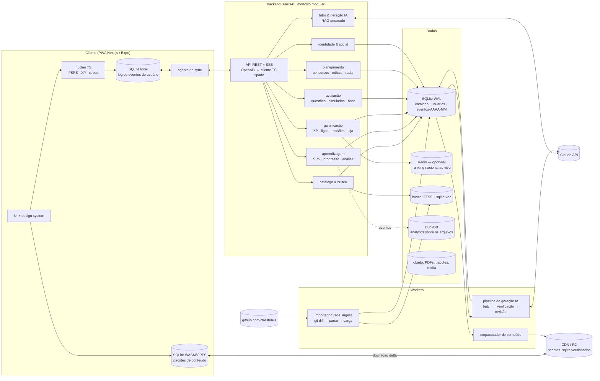
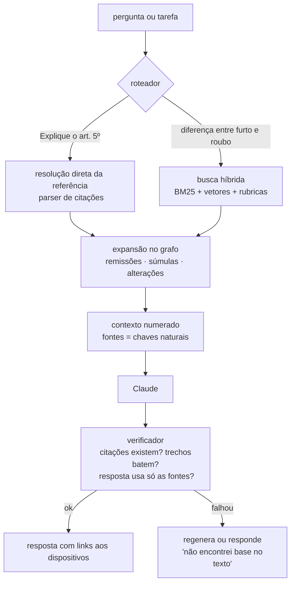
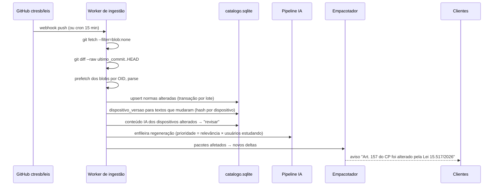

# 2. Arquitetura

## 2.1 Princípios

1. **Texto legal é a fonte da verdade; IA é derivada e citável.** Todo conteúdo gerado aponta para
   dispositivos pela chave natural (`<norma>#<caminho>`) e é invalidado quando o texto muda.
2. **Monólito modular primeiro.** Os módulos têm fronteiras de domínio e esquemas separados, mas
   começam num só deploy. Extraímos um serviço quando a escala ou a equipe pedir, não antes.
3. **Offline-first por construção.** Conteúdo chega como pacote SQLite; o progresso do usuário é um
   log de eventos só de acréscimo. Esse formato sincroniza sem conflito (§2.6).
4. **O que é caro roda em lote e com antecedência.** Explicações, flashcards e questões dos
   dispositivos relevantes são gerados em batch, verificados e cacheados. Online fica só o que é
   pessoal (tutor, correção de discursiva).
5. **O servidor é a autoridade de pontuação.** O cliente calcula XP para responder na hora; o
   servidor recalcula ao sincronizar (anti-trapaça nos rankings).

## 2.2 Visão geral



## 2.3 Módulos de domínio

| Módulo | Responsabilidade | Dados principais | Leitura/escrita |
| --- | --- | --- | --- |
| **Catálogo** | normas, dispositivos, taxonomia, referências, versões, busca | `catalogo.sqlite` | 99% leitura, cache pesado |
| **Aprendizagem** | cartões FSRS, log de revisões, domínio por dispositivo, previsões | `usuarios.sqlite` + eventos | escrita intensa (eventos) |
| **Avaliação** | banco de questões, sessões, simulados, boss fight, correção | `usuarios.sqlite` + eventos | escrita intensa |
| **Gamificação** | razão de XP, níveis, streak, ligas, missões, conquistas, moedas, loja | `usuarios.sqlite` + eventos | escrita intensa (em lote) |
| **Planejamento** | concursos, editais, cronograma, Radar de Concurso | `usuarios.sqlite` | moderado |
| **Tutor IA** | chat ancorado, explicações sob demanda, correção de discursivas | `usuarios.sqlite` | caro, com cota |
| **Identidade/Social** | contas, perfis, amizades, privacidade (LGPD) | `usuarios.sqlite` | baixo |

Regra de dependência: módulos conversam por **interfaces de aplicação** (funções/serviços) e
**eventos de domínio** (`ReviewRecorded`, `QuestionAnswered`, `DailyGoalMet`…), nunca por tabelas
alheias. É isso que permite extrair um serviço depois sem reescrever.

## 2.4 Fluxo de estudo de um artigo (exemplo: CP art. 157)

1. O cliente abre `federal/decretos-lei/1940/del-2848-1940-12-07#art-157` no pacote local: texto,
   rubrica "Roubo", 3 penas, 10 incisos do §2º e as notas (redação dada pela Lei 15.397/2026).
2. Abas carregadas do pacote, ou do servidor quando online: **Resumo IA · Explicação (nível do
   aluno) · Mapa mental · Flashcards · Questões · Pegadinhas · Jurisprudência** (súmulas que
   referenciam o artigo, via `referencia_legal`) **· Histórico** (linha do tempo das notas).
3. Cada resposta ou revisão gera um evento local → FSRS atualiza o cartão → XP/combo na tela.
4. O agente de sync envia os eventos; o servidor recalcula XP, atualiza a liga (`liga_membro`) e
   o domínio do dispositivo.

## 2.5 Arquitetura de IA



- **Modelos (Claude):** `claude-sonnet-5-5` para tutor e geração de conteúdo; `claude-haiku-5-5`
  para classificação, extração de editais e verificação barata; `claude-opus-5-5` para questões
  nível especialista e correção de discursivas. Geração em massa pela **Message Batches API**
  (custo menor, sem latência). O texto das normas vai em bloco com **prompt caching**.
- **Embeddings:** o Claude não tem modelo de embeddings. Usamos **BGE-M3** (multilíngue, self-hosted,
  sem custo por token) ou Voyage AI. Indexamos por **dispositivo** com o contexto hierárquico
  ("CP › Parte Especial › Crimes contra o patrimônio › Roubo › §2º, II").
- **Ancoragem obrigatória:** a resposta só pode afirmar o que está nas fontes recuperadas e cita as
  chaves. O verificador confere se cada citação existe e se trechos entre aspas aparecem
  literalmente no texto. Sem base, a resposta é "não encontrei no texto legal".
- **Perguntas de incidência** ("o que mais cai sobre improbidade?") não vão para o LLM: são
  consultas ao Radar (estatística sobre `questao_dispositivo`). O LLM só redige a resposta.
- **Alterações recentes:** `nota_alteracao` + `dispositivo_versao` respondem "quais artigos foram
  alterados recentemente" de forma determinística.

### Pipeline de geração de conteúdo (offline)

`seleção` (dispositivos de relevância alta/normal, qualidade alta, priorizados pelo Radar) →
`geração` (batch, prompts por tipo e por banca) → `verificação automática` (2º modelo responde a
questão sem o gabarito; precisa bater e a justificativa precisa citar o dispositivo; checagem de
alternativa única) → `pontuação` → `revisão humana por amostragem` (100% para o selo "revisado")
→ `publicação` com `modelo`, `prompt_versao` e `texto_hash` do dispositivo. Se o texto do
dispositivo mudar, o conteúdo vai para "revisar" automaticamente.

## 2.6 Offline-first e sincronização

**Conteúdo:** o empacotador gera arquivos SQLite (mesmo esquema de
`services/ingest/src/vade_ingest/schema.sql`) por **pacote**: "CF", "Código Penal", "Penal
Especial", "Concurso PF 2026"… Cada pacote tem versão = commit do acervo + versão do conteúdo IA.
Atualizações chegam como **delta** (dispositivos alterados), e há pacote completo como fallback.
No navegador, SQLite WASM com OPFS; no app, SQLite nativo.

**Dados do usuário (event sourcing):**

```
evento { id: UUIDv7 (gerado no cliente), usuario, dispositivo/cartao, tipo, payload, ts_cliente, hlc }
```

- Revisões e respostas são **fatos imutáveis**. O estado do cartão FSRS é derivado reproduzindo os
  eventos em ordem (HLC). Dois aparelhos offline não conflitam: a união dos eventos reproduzida dá o
  mesmo estado em qualquer lugar.
- Preferências (meta diária, tema) usam *last-writer-wins* por campo.
- O servidor deduplica pelo `id` (idempotência) e valida plausibilidade (tempo de resposta,
  volume/hora) antes de creditar XP.
- **Paridade cliente/servidor:** o FSRS e as regras de XP existem em Python (servidor, referência) e
  em TypeScript (cliente). Os dois rodam os mesmos vetores (`services/learning/tests/vectors.json`)
  no CI.

## 2.7 Atualização quando o acervo muda



O aviso de alteração vira um recurso do produto: o usuário que já dominava o artigo recebe uma
revisão extra ("a lei mudou, revise").

## 2.8 Escalabilidade e desempenho

| Ponto quente | Estratégia |
| --- | --- |
| Log de revisões e respostas (bilhões de linhas) | particionamento mensal por intervalo; índice `(usuario_id, criado_em)`; BRIN em tempo; arquivamento frio em Parquet/S3 |
| Rankings ao vivo | índice `liga_ranking (liga_semana_id, xp_semana DESC)` no SQLite (grupos de 30); Redis sorted sets só quando o ranking nacional ao vivo pedir |
| Leitura de conteúdo | pacotes no CDN + cache HTTP imutável por versão; a API de catálogo quase não recebe tráfego |
| Busca | SQLite FTS5 sem acento + contexto herdado (já implementado) e `sqlite-vec` para busca semântica; servidor de busca dedicado só se o FTS5 não bastar |
| Estatísticas (heatmap, Radar) | tabelas recalculadas por job no MVP; DuckDB lendo os arquivos de eventos mensais (e Parquet arquivado) para análises pesadas |
| Custo de IA | geração em batch + cache por (dispositivo, tipo, nível, banca); cotas por plano; Haiku onde dá |

## 2.9 Segurança e privacidade (LGPD)

Dados pessoais mínimos; consentimento explícito para ranking público; exportação e exclusão de
conta (direitos do titular); criptografia em trânsito e em repouso; segregação de PII no esquema
`identity`; logs sem conteúdo de discursivas; trilha de auditoria para conteúdo editorial;
rate-limit por usuário nas rotas de IA; proteção contra prompt injection nos textos (o texto legal
entra como dado delimitado, nunca como instrução).
