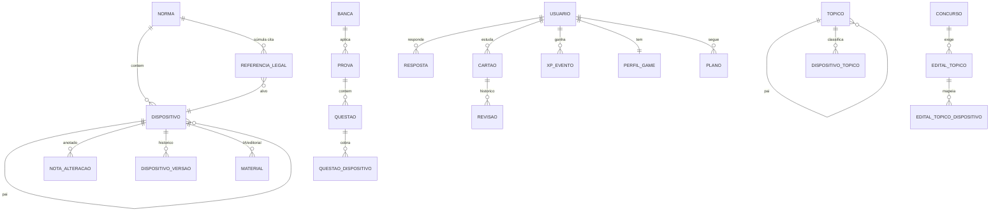

# 4. Modelo de dados

DDL completo (SQLite): [`db/sqlite/usuarios.sql`](../db/sqlite/usuarios.sql), [`db/sqlite/eventos.sql`](../db/sqlite/eventos.sql) e
[`services/ingest/src/vade_ingest/schema.sql`](../services/ingest/src/vade_ingest/schema.sql)
(SQLite: desenvolvimento e pacotes offline, com o mesmo modelo lógico do conteúdo).

## 4.1 Decisão central: chave natural de dispositivo

```
federal/decretos-lei/1940/del-2848-1940-12-07#art-157/par-2/inc-ii
└──────────── norma.id (caminho no acervo) ─┘ └── caminho do dispositivo ─┘
```

- **Estável entre reimportações.** O id numérico (`bigserial`) muda a cada carga; a chave natural não.
  Progresso, cartões, questões, materiais de IA e anotações apontam para a chave.
- **Independente de capítulos.** `art-157` não carrega "Título II / Capítulo II": se o legislador
  reorganizar divisões, o progresso do aluno continua valendo.
- **Legível e depurável.** Aparece em URLs (`/n/cp/art-157/par-2/inc-ii`), logs e citações da IA.
- **Escopos:** `adct/art-1` na CF; súmulas usam `#enunciado` e `#tese`.
- Colisão (texto com numeração repetida na origem) recebe o sufixo `~2` e gera um aviso no relatório
  de importação.

## 4.2 Esquemas por módulo



Por que SQLite: um formato só no servidor e no aparelho (o pacote offline é o próprio catálogo),
nenhum servidor de banco para instalar ou operar, e desempenho de sobra para leitura. O limite real
do SQLite é **uma escrita por vez**. Aqui ela chega em lotes (sincronização de eventos, importação),
então um servidor aguenta dezenas de milhares de usuários ativos. Para ir além, os usuários são
fatiados em N arquivos por hash do id; o SQL foi mantido portável caso um dia valha migrar para MySQL.

| Arquivo | Tabelas | Natureza |
| --- | --- | --- |
| `catalogo.sqlite` ([schema](../services/ingest/src/vade_ingest/schema.sql)) | norma, dispositivo, nota_alteracao, referencia_legal, historico_sync, falha_importacao, kv + índices FTS5 | conteúdo; leitura (a importação é a única escrita) |
| `usuarios.sqlite` ([schema](../db/sqlite/usuarios.sql)) | usuario, amizade, organizacao · banca, prova, questao, questao_dispositivo, simulado, material · flashcard, cartao, dominio, parametros_fsrs, sessao · perfil, liga_semana, liga_membro, conquista, missao, item_loja, inventario, temporada · concurso, edital_topico, plano, radar_incidencia · conversa, mensagem, uso_ia_diario | estado atual; escrita moderada |
| `eventos-AAAA-MM.sqlite` ([schema](../db/sqlite/eventos.sql)) | revisao, resposta, lancamento (XP e moedas) | fatos imutáveis do mês; só INSERT |

Os três se juntam numa conexão com `ATTACH DATABASE` quando uma consulta precisa cruzar arquivos.

## 4.3 Escala para milhões de questões e bilhões de eventos

**Volumetria estimada** (1 milhão de usuários ativos/mês, 40 interações/dia por ativo diário, 30%
de ativos diários): ~12 milhões de linhas/dia em `resposta` + `revisao` + `xp_evento`, ~4,4
bilhões/ano.

- **Um arquivo de eventos por mês** (`eventos-AAAA-MM.sqlite`) faz o papel do particionamento. Consultas do
  usuário abrem só os meses do intervalo pedido (`ATTACH`). Arquivos com mais
  de 18 meses viram Parquet no S3/R2 (consultáveis via DuckDB) e o arquivo sai do servidor.
- **PK com UUIDv7 gerado no cliente:** ordenável no tempo (localidade de índice) e idempotente na
  sincronização offline.
- **Estado materializado vs. eventos:** `cartao`, `dominio` e `perfil` são
  projeções. Dá para reconstruí-las a partir dos eventos, o que permite migrar o algoritmo (ex.: novos
  pesos FSRS) sem perder histórico.
- **Questões:** milhões de linhas não são problema. O gargalo é a seleção ("15 questões do art. 5º,
  nível intermediário, estilo CEBRASPE, que o usuário ainda não viu"). Usamos o índice parcial
  `questao_pub` + `questao_dispositivo(dispositivo_chave)` + exclusão das já respondidas pelo índice
  `resposta_usuario` do mês corrente.
- **Contadores quentes** (`questao.respostas/acertos`, `dispositivo.incidencia`) são atualizados
  em lote por job, nunca por gatilho em cada resposta.
- **Rankings:** a tabela `liga_membro` com índice `(liga_semana_id, xp_semana DESC)` resolve as ligas
  (grupos de 30). Redis (sorted sets) entra só se o ranking nacional ao vivo pedir.
- **Leituras de conteúdo** praticamente saem do banco: pacotes SQLite no CDN e cache HTTP por versão.

## 4.4 Versões e histórico de alterações

Três fontes, em ordem de confiabilidade:
1. **Notas editoriais** do texto compilado (`nota_alteracao`: "redação dada pela Lei nº X, de
   d/m/a"). Com `data_ref`, a linha do tempo do dispositivo e a consulta "alterados recentemente"
   são diretas.
2. **Diferenças entre importações** (`dispositivo_versao`): quando o `texto_hash` muda, guardamos a
   redação anterior com o commit e a data. O próprio git do acervo é a trilha de auditoria.
3. **Trechos tachados** preservados por algumas fontes (`redacao_anterior`).

## 4.5 Taxonomia e dificuldade

- `topico` é uma árvore genérica (área → disciplina → tema → subtema). `dispositivo_topico` guarda a
  origem (regra | ia | editor) e a confiança. A camada 0 vem de `vade_ingest.classify` (catálogo de
  ~60 normas + palavras-chave + ramo/tema das súmulas do STJ).
- `dispositivo.nivel` e `questao.nivel` são recalculados por job (`vade_learning.difficulty`):
  taxa de erro suavizada, incidência, complexidade textual e carreira-alvo. Com volume suficiente,
  `questao.nivel_calibrado/discriminacao` vêm de um modelo de TRI (2PL).
