# 5. Pipeline de importação das leis

Implementado em [`services/ingest`](../services/ingest) (Python 3.11+, só biblioteca padrão + git).

## 5.1 Etapas

```mermaid
flowchart LR
  A[git fetch\n--filter=blob:none] --> B{já importou\nantes?}
  B -- não --> C[ls-tree -r\nlista completa]
  B -- sim --> D[diff --raw\nultimo_commit..HEAD]
  C & D --> E[filtro is_norm_path\n.md, sem pastas _internas]
  E --> F[compara OID\ncom content_hash]
  F --> G[prefetch em lote\nfetch --stdin por OID]
  G --> H[cat-file --batch\nstream de conteúdo]
  H --> I[frontmatter.parse\nYAML tolerante]
  I --> J{jurisprudência?}
  J -- sim --> K[precedent.parse\nenunciado · ramo · referências]
  J -- não --> L[structure.parse_body\nárvore de dispositivos]
  K & L --> M[quality.assess]
  M --> N[classify\náreas · sigla · relevância]
  N --> O[(upsert transacional\nnorma + dispositivos + notas + refs)]
  O --> P[resolve_references]
  P --> Q[grava ultimo_commit]
```



| Módulo | Arquivo | O que faz |
| --- | --- | --- |
| Fontes | `sources.py` | `GitSource` (object store, diff, prefetch, cat-file) e `FsSource` (diretório) |
| Cabeçalho | `frontmatter.py` | subconjunto plano de YAML, tolerante: linha ruim vira aviso, não exceção |
| Estrutura | `structure.py` | divisões por palavra-chave, artigos/§/incisos/alíneas/itens/penas, rubricas, notas, revogado/vetado, aspas, ADCT, tachados |
| Precedentes | `precedent.py` | enunciado/tese, ramo/tema, `LEG:… ART:…` → caminhos |
| Qualidade | `quality.py` | nota 0–1 e faixa alta/média/baixa (detecta OCR quebrado) |
| Classificação | `classify.py` | catálogo de ~60 normas, palavras-chave, efeito concreto |
| Documento | `document.py` | monta `NormDocument` (esfera, datas, metadados) |
| Carga | `loader.py` + `schema.sql` | SQLite com FTS5 sem acento, sync completo/incremental, busca |
| CLI | `cli.py` | `sync`, `parse`, `search`, `stats` |

## 5.2 Parser do YAML

O cabeçalho é sempre `chave: valor` plano. Um parser YAML completo aborta o lote com um único
arquivo malformado (e o acervo recebe milhares de arquivos por commit, de dezenas de raspadores).
Por isso usamos um parser do subconjunto:
- aspas duplas com `\"`; aspas simples com `''`; `true/false`; `null`/`~`/vazio → `None`;
- chaves de data (`data`, `data_publicacao`, `baixado_em`) viram `date`, com ou sem aspas
  (os municipais vêm entre aspas);
- linha sem `:` ou chave duplicada → aviso registrado, importação continua.

## 5.3 Indexação dos artigos

1. **Hierarquia por palavra-chave.** PARTE(1) > LIVRO(2) > TÍTULO(3) > SUBTÍTULO(4) > CAPÍTULO(5) >
   SEÇÃO(6) > SUBSEÇÃO(7). Ao abrir uma divisão de rank *r*, fecham-se as de rank ≥ *r*. Divisões
   sem `#` (textos originais) são aceitas quando a linha inteira está em maiúsculas.
2. **Dispositivos** detectados sobre a linha sem `**`. Sufixo só colado ao número (`1º-A`,
   `359-M-A`); com espaço é separador. Inciso sem travessão só é aceito se continuar a sequência
   romana (I, II, III…).
3. **Citações entre aspas** (texto que a lei insere em outra) ficam como conteúdo do artigo
   alterador e não criam dispositivos.
4. **Notas** entre parênteses com gatilhos (redação dada, acrescido, incluído, revogado, vetado,
   vide, vigência, renumerado) saem do texto e viram `Note(kind, text, ref)`; `ref` é a norma
   alteradora.
5. **Revogado/vetado:** texto vazio + nota de revogação/veto, ou texto começando por "Revogado".
6. **Caminho** = escopo (`adct/`) + `art-N[sufixo]` + filhos (`par-1a`, `inc-ii`, `ali-b`,
   `item-1`, `pena`). Colisão → `~2` + aviso.
7. **Busca:** FTS5 `unicode61 remove_diacritics 2` sobre rótulo, rubrica (peso 4) e texto;
   revogados fora; bônus para normas de relevância alta.

## 5.4 Atualização contínua

- **Gatilho:** webhook de push do GitHub (ou cron de 15 min) enfileira um job `sync`.
- **Incremental:** `git diff --raw --no-renames ultimo_commit..HEAD`. Renomeação vira remoção +
  inclusão; o id muda, e o job de reconciliação migra o progresso dos usuários quando o `urn` (ou
  `tipo+numero+ano`) for o mesmo.
- **Idempotente:** se o OID não mudou, nada é feito. Reexecutar o mesmo commit não faz nada
  (testado).
- **Falhas isoladas:** uma norma que quebra vai para `falha_importacao` com o erro; o lote segue.
- **Reconciliação completa** (`--full`) semanal: compara a árvore inteira e remove normas que sumiram.
- **Pós-importação** (próximas etapas): `dispositivo_versao` para textos alterados; materiais de IA
  dos dispositivos alterados → `revisar`; regeneração priorizada; novos deltas dos pacotes;
  notificação "a lei mudou" para quem estuda o dispositivo.

## 5.5 Desempenho medido

| Cenário | Resultado |
| --- | --- |
| 3.737 normas (CF, LCs, leis 2002/2006/2018/2021, DLs 1940, 3 recortes estaduais, SV, súmulas STJ, ANAC) | 25 s, 0 falhas, 64.065 dispositivos |
| Reexecução sem mudanças | 0 arquivos lidos (diff vazio) |
| Prefetch de 2.134 blobs | 3 s |

Projeção para o acervo inteiro (~1,06 M normas): ~2 h numa thread. Na produção, 8 workers por
prefixo (`estaduais/SP`, `federal/decretos`…), cada um no seu arquivo SQLite, unidos no fim (`ATTACH` + `INSERT … SELECT`).

## 5.6 Como rodar

```bash
git clone --filter=blob:none --no-checkout https://github.com/ctresb/leis.git acervo
```

```bash
cd services/ingest && PYTHONPATH=src python -m vade_ingest sync --repo ../../acervo --db catalogo.sqlite --prefix constituicao.md --prefix federal/leis-complementares
```

```bash
cd services/ingest && PYTHONPATH=src python -m vade_ingest search --db catalogo.sqlite "legitima defesa"
```

## 5.7 Próximos passos do pipeline

1. Tabela `dispositivo_versao` no catálogo SQLite (histórico de redações entre importações).
2. Contexto hierárquico por dispositivo (`contexto`: "CP › Parte Especial › … › Roubo") e embeddings.
3. Remissões textuais ("nos termos do art. 5º desta Lei", "art. 121 do Código Penal") → `referencia_legal` com `origem_tipo = 'remissao_textual'`.
4. Datas das notas (`data_ref`) para a linha do tempo.
5. Parser específico para atos de reguladores (anexos, tabelas) e para temas de repercussão geral/repetitivos.
6. Re-OCR dos textos de qualidade baixa a partir do PDF original (`arquivo:` no cabeçalho).

## 5.8 Botão "Verificar atualização" (o acervo muda a cada poucos minutos)

O `ctresb/leis` recebe vários commits por hora, com milhares de arquivos cada. Correr atrás de cada
commit seria caro e inútil: quase tudo cai fora do que o usuário estuda. A atualização foi dividida
em duas operações de custo muito diferente (`updater.py`), medidas contra o GitHub real:

| Operação | O que faz | Custo medido |
| --- | --- | --- |
| **Verificar** | `git ls-remote` (último commit, não baixa nada); se mudou, `git fetch` só de commits e árvores; calcula o diff: commits novos, arquivos alterados, **quantos caem no recorte**, por área | 0,5 s sem novidade; ~2 s com 4 commits / 4.926 arquivos |
| **Atualizar** | baixa só o conteúdo dos arquivos do recorte que mudaram e aplica o diff numa transação | 1,2 s quando nada do recorte mudou; ~150 normas/s quando mudou |

Consequências:
- **N commits pendentes viram um diff só.** Tanto faz se passaram 4 ou 400 commits; o custo é o
  dos arquivos que mudaram, uma vez (testado: 5 commits no mesmo arquivo → 1 reimportação).
- **Recorte:** só as pastas escolhidas são importadas (atalhos "Mínimo" e "Essencial federal", ou
  navegando pela árvore). Recorte vazio é recusado, porque importaria ~1 milhão de arquivos, a
  menos que se confirme explicitamente (`--tudo`).
- **Mudança de recorte:** pastas adicionadas depois da 1ª importação entram na próxima atualização
  mesmo sem terem mudado no GitHub; pastas removidas têm as normas retiradas.
- **Falhas não se perdem:** se o conteúdo de um arquivo não chega (rede caiu), ele fica em
  `falha_importacao` e é retentado na próxima atualização, mesmo que não apareça mais no diff.
- **Uma atualização por vez** (trava), e a busca continua funcionando durante a gravação (WAL).
- **Histórico:** cada atualização grava de/para commit, contagens e as normas alteradas.
- **Modo automático (opcional):** a página verifica a cada 15 min enquanto estiver aberta e pode
  atualizar sozinha; no servidor, `serve --verificar-a-cada 30 --atualizar-auto`. Intervalos de
  15–60 min agrupam vários commits num único diff.

Para produção, o mesmo `Updater` roda como job agendado (cron) ou disparado pelo webhook de push
do GitHub, e o botão continua disponível no painel de administração.

```bash
cd services/ingest && PYTHONPATH=src python -m vade_ingest serve --repo ../../acervo --db catalogo.sqlite
```
