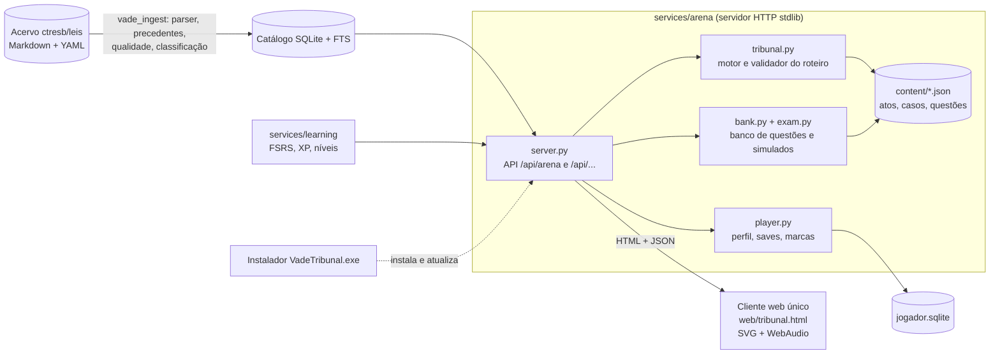

# Arquitetura

Visão resumida do que existe hoje no repositório. O desenho de longo prazo (API, apps, sincronização) está em
[02-arquitetura.md](02-arquitetura.md).

## Componentes

## Fluxo de dados

1. **Ingest.** `services/ingest` lê o acervo (clone parcial do ctresb/leis), analisa a estrutura de cada norma e
   grava um catálogo SQLite com busca FTS. O painel `/acervo` verifica e aplica atualizações incrementais.
2. **Arena.** `services/arena` é um servidor HTTP da biblioteca padrão. Entrega o cliente, o roteiro e as questões,
   enriquece as leis citadas com o texto vigente do catálogo, calcula o XP e grava o progresso.
3. **Cliente.** Um único arquivo, `web/tribunal.html`, roda o motor das cenas no navegador: personagens e cenários em
   SVG, sons em WebAudio, menu da carreira e cenas (`say`, `testimony`, `investigate`, `choiceScene`,
   `dilemmaScene`, `verdict`, `credits`).

## Modelo de conteúdo JSON

`content/tribunal.json` traz `normas`, `personagens` (com visual e voz) e `atos`. Cada `content/atoN.json` e
`atoNx.json` traz `episodios`, cada um com `id`, `ato`, `nivel` e um grafo `cenas`. Tipos de cena: `titulo`,
`dialogo`, `depoimento`, `apresentar`, `escolha`, `decidir`, `investigar` e `veredicto`. Falas têm personagem (`q`),
expressão (`e`), texto (`t`) e efeitos. Condições `se`/`!marca` e `variantes` do veredicto ligam o roteiro às
escolhas morais. São 5 atos e 43 casos, carregados por `tribunal.load()`.

## Validação contra a lei vigente

`python jogar.py validar --db catalogo.sqlite` executa `tribunal.validate`: confere referências entre cenas,
alcançabilidade, provas obrigatórias entregues pela própria cena, tipos e expressões válidos e se cada fundamento
(chave natural da norma e trecho citado) ainda consta no texto vigente do catálogo. Questões e casos passam pela
mesma verificação, o que denuncia conteúdo desatualizado quando uma lei muda.

## Salvamento

`player.py` usa SQLite (`jogador.sqlite`) com as tabelas `jogador`, `partida`, `tribunal_save`, `marca` e
`questao_vista`. O cliente salva a cada cena e informa o resultado do caso; o servidor recalcula a pontuação
(`tribunal.score`) com limites e grava as marcas só quando o caso é vencido.

## Instalador e CI

`instalador/vade_launcher.py` é compilado com PyInstaller em um único `VadeTribunal.exe`. O workflow
`.github/workflows/instalador.yml` roda em `windows-latest` a cada mudança em `instalador/`: executa os testes do
arena e do learning, compila o executável e publica na Release `instalador`. O instalador baixa o jogo (fetch +
reset), faz o clone parcial do acervo, importa o recorte e verifica leis novas a cada 30 minutos.

## Decisões (ADR curto)

**ADR-1. SQLite para catálogo e progresso.** Contexto: jogo local, sem servidor de banco, muitas normas. Decisão:
SQLite com FTS para o catálogo e um arquivo por jogador. Consequência: instalação simples e portátil; multiusuário
e sincronização exigem outra camada (ver roadmap).

**ADR-2. Biblioteca padrão, sem dependências.** Contexto: o instalador precisa funcionar com o Python embutido.
Decisão: servidor `http.server`, testes `unittest` e nenhuma dependência externa. Consequência: instalação sem
`pip`, mas sem os recursos prontos de um framework.

**ADR-3. SVG procedural e áudio sintetizado.** Contexto: licenças de assets e tamanho do pacote. Decisão: gerar
personagens, cenários e sons por código. Consequência: todo asset é obra original e leve; o detalhe artístico
depende de trabalho manual no código.

**ADR-4. Conteúdo validado.** Contexto: o jogo ensina lei, que muda. Decisão: todo conteúdo cita dispositivos pela
chave natural e é conferido contra o texto vigente pelo comando `validar`. Consequência: erros jurídicos e conteúdo
desatualizado aparecem cedo, ao custo de manter o catálogo disponível para a validação.

**ADR-5. Cliente web único.** Contexto: um só arquivo simplifica a distribuição pelo instalador. Decisão:
`tribunal.html` concentra CSS, SVG, som e motor de cenas. Consequência: sem etapa de build; o arquivo é grande e
exige cuidado em edições concorrentes.
